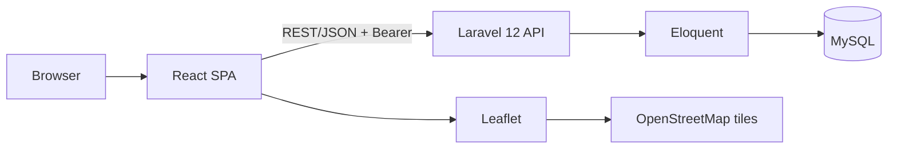

# Architecture

- **Frontend:** route-level lazy chunks for map/admin; Three.js scene is a separate lazy chunk loaded only when 3D is allowed.
- **Auth boundary:** `auth:sanctum`; **admin boundary:** `admin` middleware inside it; **DB boundary:** Eloquent only, user-scoped itinerary queries.
- **Map dependency:** OSM tiles are external; tile failure shows a message, data stays usable.
- **Deployment boundary:** static `frontend/dist` + PHP-FPM API behind HTTPS (hosting is TBD-003).
