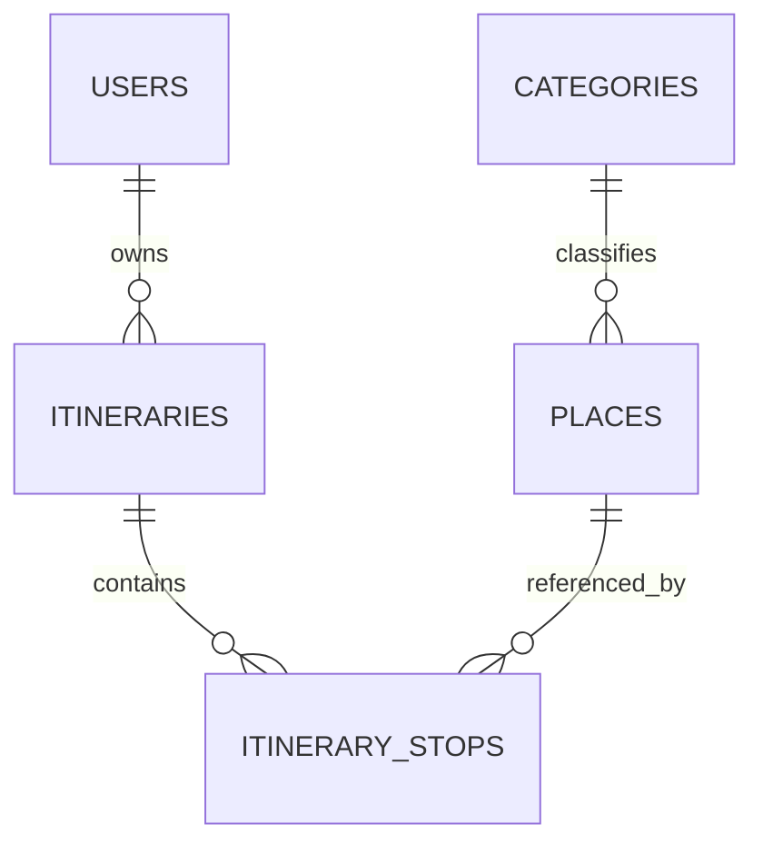

# Database (MySQL)

| Table | Columns (type) | Keys / indexes / deletion |
|---|---|---|
| users | id, username(50) **unique**, name, email **unique**, email_verified_at?, password, role(20, default `user`, indexed), remember_token, timestamps | Added by ALTER migration over the framework table |
| categories | id, name(80) unique, slug(100) unique, timestamps | places FK RESTRICT |
| places | id, category_id FK, name(150, indexed), slug unique, description text, image_url(2048)?, opening_hours(255), distance_km dec(6,2), latitude dec(10,7), longitude dec(10,7), estimated_visit_minutes?, is_verified bool, timestamps | category RESTRICT |
| itineraries | id, user_id FK, title(120), itinerary_date?, start_time (default 09:00), timestamps; index (user_id, created_at) | user CASCADE |
| itinerary_stops | id, itinerary_id FK, place_id FK, position, timestamps; unique (itinerary_id, position), unique (itinerary_id, place_id) | itinerary CASCADE; **place RESTRICT** (TBD-017) |
| personal_access_tokens | published by Sanctum | |

Seeds: `UserSeeder` (non-production only, idempotent), `CategorySeeder` (7), `PlaceSeeder` (11 **demo**, unverified). Migrations: run `php artisan migrate`; never `migrate:fresh` in production.
